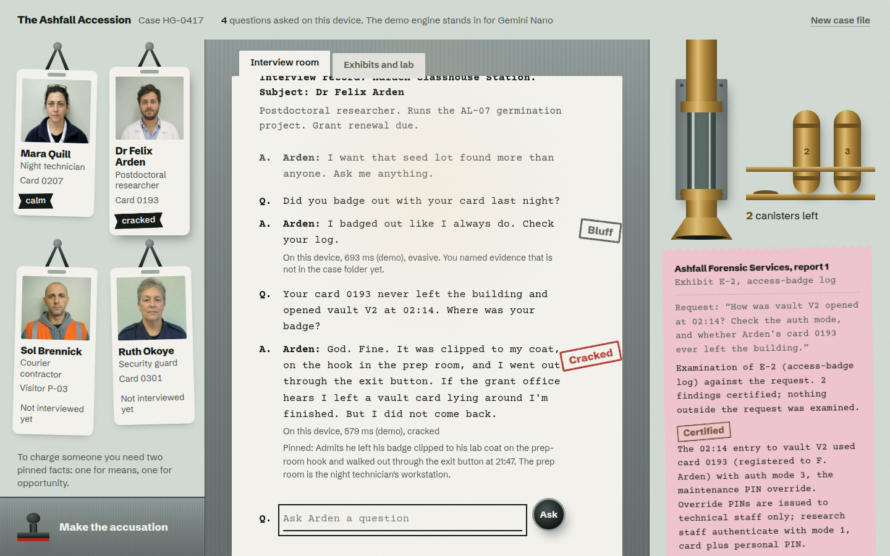
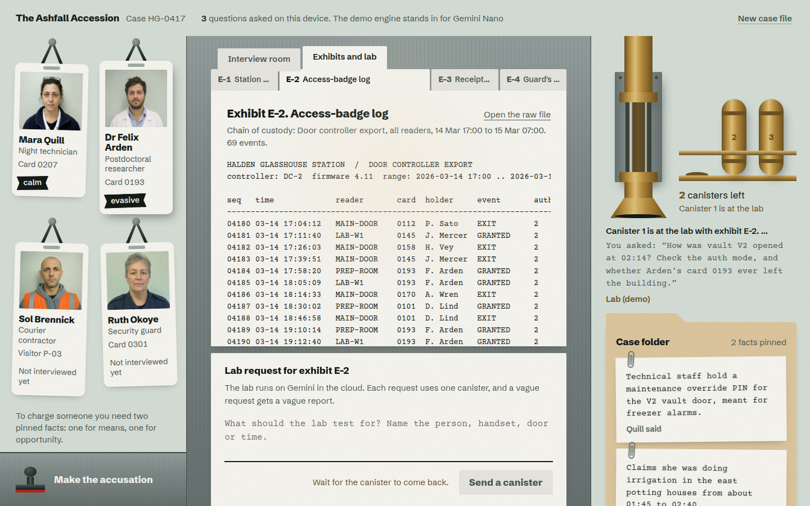

# Cold Case Lab: The Ashfall Accession

A one-case detective game for Chrome, about 10 to 15 minutes long, where **deciding what runs where is the gameplay**.

You question four people in an interview room. Their answers come from Gemini Nano, **on your device**: instant and free, so ask as much as you like. The evidence is different. You get **three lab requests** to the **cloud** forensic lab, which reads long logs, a photographed receipt and a two-page statement. Choosing which exhibit to send, and exactly what to test it for, decides the case.



## The case

> Overnight, the last viable seeds of the Ashfall lily vanished from the seed vault of a small research greenhouse.
> Four people were in or near the building. You have their records, their answers, and three lab requests.

- **People:** the night technician, a postdoc whose grant depends on the seeds, a courier contractor, and the night guard (witness).
- **Exhibits:** these are real files in [`public/exhibits/`](public/exhibits/).
  - A 151-row carrier export of the station handsets.
  - A 69-event door-controller log.
  - A photographed till receipt.
  - The guard's two-page statement.
- **Pressure:** everyone has a weak point, but they only crack when you name evidence that is **already pinned in your case folder**. Naming it without holding it is a bluff, and they will call it.
- **The lab:** a vague request ("anything suspicious?") gets a vague report. A precise request (a person, a time, a property) gets certified findings, which are pinned in the case folder.
- **The accusation:** name the culprit and pick two pinned facts, one proving **means** and one proving **opportunity**. The check is deterministic code, not AI. Confessions can be retracted; lab findings cannot.

The case is fair-play. It can only be solved by combining interrogation with at least two of the three lab calls, and one exhibit is a red herring that wastes a call. The authored case lives in [`src/case/`](src/case/). The solution is in `solution.ts`, if you want spoilers.

## Why hybrid: what runs where

| Task | Where | Inference mode | Why |
| --- | --- | --- | --- |
| A suspect answers a question | **On device** (Gemini Nano, Chrome Prompt API) | `PREFER_ON_DEVICE` | Short, single-turn, needs low latency and costs nothing. Players ask dozens of questions. |
| Same, when Nano is unavailable | **Remote line** (cloud fallback) | `PREFER_ON_DEVICE` falls back | The game still works in any browser. The UI says so honestly: chip `REMOTE LINE · 2.1 s` and a one-line notice. |
| Lab report on an exhibit | **Cloud lab** (Gemini in the cloud) | `ONLY_IN_CLOUD` | Long documents (a 151-row CSV), images (the receipt photo) and careful reasoning. Rationed to 3 calls. |
| Accusation verdict | **Plain code** | none | The verdict must be exact and reproducible, so no model decides it. |

Every answer and report carries a route note ("On this device, 412 ms", "Remote line, 2.1 s", "Lab, 5.8 s"; read aloud as `ON DEVICE · 412 ms` and so on) built from the SDK's `response.inferenceSource` and measured latency. The header counts questions answered on device; the tube station counts the canisters (lab requests) left.

### Models perform, they do not author

- **Per-character fact boundary.** A character's prompt contains only that character's sheet: what they know, their account of the night, and a vague hint of what they hide. Their secrets are sent only once the detective has earned them (pressure applied with pinned evidence, or already cracked). Nothing about the other characters or the solution is ever in the prompt. Unit tests enforce this ([`tests/prompts.test.ts`](tests/prompts.test.ts)).
- **Code decides the crack.** [`src/game/pressure.ts`](src/game/pressure.ts) checks whether the question names a pressure point and whether its evidence is pinned. The model is then told to crack or to stay evasive.
- **Single-turn prompts.** On-device Gemini Nano has no multi-turn chat, so each turn is one `generateContent` call. It carries the persona, the facts and the last 3 exchanges.
- **Structured output.** Characters return `{ reply, mood, revealed }`, where `revealed` is filtered to the fact ids allowed this turn. The lab returns `{ findings: [{ factId, text }], summary }`. Output is parsed defensively ([`src/ai/parse.ts`](src/ai/parse.ts)):
  - JSON wrapped in prose or code fences is extracted.
  - Invalid output becomes a safe line the character would say.
  - Unknown fact ids are dropped.
- **Lab grading = model + keywords.** The model judges which lab truths the request actually asked about. Each truth also has a keyword rule:
  - A model finding is kept only if the request touches its subject, so a lenient model cannot hand out everything.
  - A fully matching request always gets its finding, so a stingy or broken model cannot rob a precise request.

## Run it

Needs Node 22+ and npm.

```sh
npm install
npm run dev          # http://localhost:5173  (demo engine until Firebase is configured)
```

| Script | What it does |
| --- | --- |
| `npm run dev` | Vite dev server |
| `npm run build` | Typecheck, then production build to `dist/` |
| `npm run typecheck` | `tsc --noEmit`, strict |
| `npm test` | Vitest unit tests |
| `npm run e2e` | Plays the whole case in Chrome against the production build (see below) |
| `npm run shoot` | Screenshots at 1440x900 and 390x844 into `shots/` |
| `npm run exhibits` | Regenerates the phone and badge logs (deterministic) |
| `node scripts/render-receipt.mjs` | Re-renders the receipt photo with headless Chrome |

`e2e` and `shoot` use `playwright-core` with a locally installed Chrome (`/usr/bin/google-chrome` by default, or set `CHROME_PATH`). They never download a browser.

URL switches (demo engine only): `?engine=mock` forces the demo engine, `?nano=0` simulates a browser without Gemini Nano, `?speed=4` divides the simulated latencies.

## Configure Firebase AI Logic

All AI inference goes through the [Firebase AI Logic](https://firebase.google.com/docs/ai-logic) web SDK (`firebase/ai`, Firebase 13) with the Gemini Developer API backend (`GoogleAIBackend`). No other model API is used.

1. Create a Firebase project and add a web app. Enable **AI Logic** with the **Gemini Developer API**.
2. Copy `.env.example` to `.env.local` and fill it in:

| Variable | Required | Notes |
| --- | --- | --- |
| `VITE_FIREBASE_API_KEY` | yes | Web app config |
| `VITE_FIREBASE_PROJECT_ID` | yes | |
| `VITE_FIREBASE_APP_ID` | yes | |
| `VITE_FIREBASE_AUTH_DOMAIN` | no | Defaults to `<project>.firebaseapp.com` |
| `VITE_FIREBASE_STORAGE_BUCKET` | no | |
| `VITE_FIREBASE_MESSAGING_SENDER_ID` | no | |
| `VITE_RECAPTCHA_SITE_KEY` | yes | reCAPTCHA Enterprise (Fraud Defense) site key for App Check |
| `VITE_APPCHECK_DEBUG` | no | `1` in local development to use an App Check debug token |
| `VITE_CLOUD_MODEL` | no | Cloud model, default `gemini-3.5-flash-lite` |
| `VITE_BASE` | no | Base path, e.g. `/cold-case-lab/` for GitHub Pages |

If any required value is missing, the app runs the demo engine and says so on the title screen.

### App Check

AI Logic calls are protected with [App Check](https://firebase.google.com/docs/app-check) using reCAPTCHA Enterprise (Fraud Defense in the Firebase console):

1. In Google Cloud, create a score-based reCAPTCHA Enterprise **Web** key for your domain(s) and `localhost` (no checkbox challenge), and put its id in `VITE_RECAPTCHA_SITE_KEY`.
2. In the Firebase console, open **App Check**, register the web app with the **Fraud Defense** provider using the same site key, then **enforce** App Check for AI Logic. (The classic reCAPTCHA v3 provider is deprecated in the console.)
3. For local development, set `VITE_APPCHECK_DEBUG=1`. The app then sets `self.FIREBASE_APPCHECK_DEBUG_TOKEN = true` before `initializeAppCheck`, and the SDK prints a debug token in the browser console. Register it under **App Check, Apps, Manage debug tokens**.

### Gemini Nano in Chrome

On-device interrogation uses Chrome's built-in Prompt API (`LanguageModel`), on hardware Chrome supports for Gemini Nano. Clicking **Open the case** calls `initializeDeviceModel()`, which needs a user gesture because it may start the model download. The title screen shows the download progress. While Nano downloads, `PREFER_ON_DEVICE` answers on the remote line, so play never blocks. If the browser has no `LanguageModel`, or availability is `unavailable`, every question goes to the remote line and the UI shows that.

## The demo engine

The real engine ([`src/ai/firebase-engine.ts`](src/ai/firebase-engine.ts)) and the demo engine ([`src/ai/mock-engine.ts`](src/ai/mock-engine.ts)) implement the same `AiEngine` interface ([`src/ai/engine.ts`](src/ai/engine.ts)). The demo engine lets the whole game be played and tested on machines without a GPU or Gemini Nano (CI, a headless server):

- **Not a language model.** It answers from the authored fact sheets: topic keywords pick the character's own lines, pressure gives the authored admission, a bluff gives the authored deflection. Lab reports come from the same keyword rules as the grading fallback.
- **Realistic, deterministic latencies.**

  | Route | Latency |
  | --- | --- |
  | On device | 300 to 700 ms |
  | Remote line | 1.8 to 2.6 s |
  | Cloud lab | 4 to 7 s |

  Each latency is derived from a hash of the request, so runs are reproducible.
- **Same output path as a real model.** It returns raw JSON text (the lab reply is wrapped in prose), so the same hardened parsers run.
- **Never pretends to be Gemini.** The header says the demo engine is standing in for Gemini Nano, the title screen explains it, and every route note carries a "(demo)" mark.

## Tests

- **Unit (Vitest):** 89 tests.
  - Prompt builders never leak another character's facts, unearned secrets, lab truths or the solution.
  - Accusation logic.
  - Lab grading: vague against precise requests, a lenient model, a stingy model, unusable output.
  - Demo-engine routing labels and latencies.
  - JSON hardening: text around JSON, invalid JSON, wrong types, foreign ids.
  - Save and restore, including corrupt saves and an interrupted lab call that returns its seal.
  - Case integrity: the exhibits contain the facts the lab certifies.
- **E2E (Chrome):** 25 checks across two runs.
  - Run 1: the intended solve path at 1440 px to a correct accusation, with a reload in the middle.
  - Run 2: at 390 px with no on-device model, remote-line routing, three lab calls including a vague one, a wrong accusation, and a new case file.

## Design

The interface is one room: the station's seed-bank office at night, turned into an interview room. Everything on screen is an object in it.

- **The title:** the empty room photographed at night. The lamp comes up, then the case name settles on the wall.
- **Left wall:** four staff ID badges on lanyards. The person you are questioning hangs straight and lifted; the mood is a word on label-maker tape.
- **The table:** a steel desk under one enamel lamp. The interview record is a typed sheet; new answers type on letter by letter, and a red rubber stamp lands in the margin when someone cracks. Your question is the sheet's last line, sent with a round rubber key.
- **The loud element:** a **brass pneumatic-tube station** on the right wall with a rack of three canisters, one per lab request. Sending a request fires a canister up the tube; the glass glows and glints while the lab works, and the report drops out of the mouth as a pink carbon slip.
- **Case folder:** a manila folder under the tube. Pinned facts are typed slips under paperclips (pink for lab findings, a red stamp for admissions); the four exhibits are evidence tags tucked in its pocket.
- **Colour:** painted mint-grey wall, brushed steel, typing paper. Brass is the only signal colour and belongs to the lab. Stamp red appears only as rubber-stamp ink.
- **Type:** Schibsted Grotesk for everything you read in the interface; Courier Prime only for typed material (the interview record, exhibits, lab slips and the charge sheet's fields).

On phones the same objects stack: the tube station becomes a brass bar across the top, then file-folder tabs (People, Room, Board, Lab). Every animation has a `prefers-reduced-motion` fallback.

### Screenshots

`npm run shoot` writes these to [`shots/`](shots/) at 1440x900 and 390x844 (demo engine):

| | Desktop | Phone |
| --- | --- | --- |
| Title | [01-title-desktop](shots/01-title-desktop.png) | [01-title-mobile](shots/01-title-mobile.png) |
| Interview record | [02-interrogation-desktop](shots/02-interrogation-desktop.png) | [02-interrogation-mobile](shots/02-interrogation-mobile.png) |
| Case folder | | [02b-board-mobile](shots/02b-board-mobile.png) |
| Canister at the lab | [03-lab-in-progress-desktop](shots/03-lab-in-progress-desktop.png) | [03-lab-in-progress-mobile](shots/03-lab-in-progress-mobile.png) |
| Lab report | [04-lab-report-desktop](shots/04-lab-report-desktop.png) | [04-lab-report-mobile](shots/04-lab-report-mobile.png) |
| Charge sheet | [05a-accuse-dialog-desktop](shots/05a-accuse-dialog-desktop.png) | [05a-accuse-dialog-mobile](shots/05a-accuse-dialog-mobile.png) |
| Verdict | [05-accusation-result-desktop](shots/05-accusation-result-desktop.png) | [05-accusation-result-mobile](shots/05-accusation-result-mobile.png) |



## Deploy to GitHub Pages

```sh
VITE_BASE=/your-repo-name/ npm run build   # then publish dist/
```

Add your Firebase values as build-time environment variables (for example, repository secrets in a Pages workflow). They are public web config by design; App Check protects the backend.

## Project layout

```
src/case/      authored case: characters, exhibits + lab truths, solution (typed data)
src/ai/        AiEngine interface, Firebase engine, demo engine, prompts, parsing, config
src/game/      state + persistence, pressure gating, lab grading, accusation, controller
src/ui/        vanilla TypeScript DOM components
src/styles/    tokens and components
public/        exhibits, self-hosted fonts
scripts/       exhibit generators, Chrome harness, e2e, screenshots
tests/         Vitest suites
```

## License

Code, case and exhibits: [Apache License 2.0](LICENSE).

## Credits

- **Schibsted Grotesk** by the Schibsted Grotesk Project Authors, SIL Open Font License 1.1, self-hosted from [`@fontsource/schibsted-grotesk`](https://fontsource.org/fonts/schibsted-grotesk). See [`public/fonts/OFL-SchibstedGrotesk.txt`](public/fonts/OFL-SchibstedGrotesk.txt).
- **Courier Prime** by the Courier Prime Project Authors, SIL Open Font License 1.1, self-hosted from [`@fontsource/courier-prime`](https://fontsource.org/fonts/courier-prime). See [`public/fonts/OFL-CourierPrime.txt`](public/fonts/OFL-CourierPrime.txt).
- **Photos:** the interview-room photo (`public/img/room.*`) and the four staff badge portraits (`public/img/{mara,felix,sol,ruth}.*`) are AI-generated for this project. They do not show real people.
- Built with [Firebase AI Logic](https://firebase.google.com/docs/ai-logic), [Vite](https://vite.dev), [Vitest](https://vitest.dev) and [Playwright](https://playwright.dev) (`playwright-core`).

All people, places, companies and phone numbers in the case are fictional.
